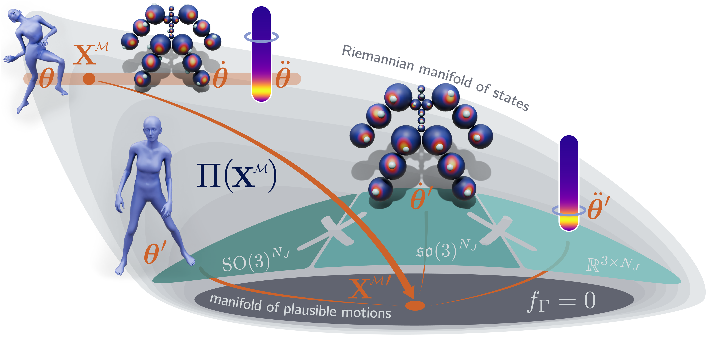

<h1 align="center">Geometric Neural Distance Fields<br>for Learning Human Motion Priors</h1>

<p align="center"><strong>CVPR 2026 Highlight</strong></p>

<p align="center">
  Zhengdi Yu<sup>1</sup> · Simone Foti<sup>1</sup> · Linguang Zhang<sup>2</sup> · Amy Zhao<sup>2</sup><br>
  Cem Keskin<sup>2</sup> · Stefanos Zafeiriou<sup>1</sup> · Tolga Birdal<sup>1</sup>
</p>

<p align="center"><sup>1</sup> Imperial College London &nbsp; <sup>2</sup> Meta Reality Labs</p>

<p align="center">
  <a href="https://circle-group.github.io/research/NRMF/"></a>
  &nbsp;
  <a href="https://arxiv.org/abs/2509.09667"></a>
  &nbsp;
  <a href="https://youtu.be/jbW68A2aYWs"></a>
</p>

<p align="center">
  <a href="https://circle-group.github.io/research/NRMF/">
    
  </a>
</p>

## Setup

Clone with Git LFS installed (`git lfs install` before cloning, or `git lfs pull` afterward)
to download the bundled checkpoint assets.

- Python 3.10+, a CUDA GPU.
- Install: `torch`, `numpy`, `scipy`, `smplx`, `trimesh`, `pyrender`, `Pillow`.
- `pyrender` renders off-screen via EGL (already selected). A working OpenGL/EGL stack
  is required for the GIF output.

## Denoising

Recover clean motion from a noisy input pose sequence (all joints observed and perturbed):

```bash
python denoise.py
```

→ `results/denoise.gif`  (columns: input noisy · ground truth · NRMF denoised)


## Recovery (leg in-filling)

The leg joints are treated as unobserved and inferred from the observed upper body and
root. Three recovery options are provided:

```bash
# 1. combo: hybrid field + in-loop pose prior + post-hoc contact grounding
# 2. hybrid field + eikonal RMF-integrator (self-scaling projection) + post-hoc contact grounding
# 3. combo_perjoint: per-joint field + in-loop pose prior + post-hoc contact grounding
python recover.py --model combo
# Alternatives: --model proj_hybrid or --model combo_perjoint
```

→ `results/recover_<model>.gif`  (columns: input legs-occluded · ground truth · NRMF recovered)

## Training

The fields can be retrained from scratch. Training needs a motion set of SMPL body poses
with root translation at 30 fps, split into `train`/`vald` (the AMASS corpus, processed to
per-frame SMPL parameters); point `--root` at that directory. It is not bundled (it is
large); the shipped checkpoints were trained on it. Per-joint noise scales and
normalisation statistics are computed from the data automatically. All fields use
denoising score matching (`--objective both`). Each command specifies a training configuration;
a 768-wide field takes roughly a day on one modern GPU.

Velocity / transition and acceleration fields (windowed distance field):

```bash
# per-joint velocity field (used for recovery)
python gen/train.py --root <DATA> --out checkpoints/field_perjoint \
  --per_joint_sigma --accel joint --mask --objective both \
  --d_model 768 --layers 6 --ff 3072 --window 90 --stride 10 --batch 128 \
  --lr 1e-4 --warmup 3000 --steps 50000

# hybrid velocity field (used for denoising) — same, with --hybrid_head
python gen/train.py --root <DATA> --out checkpoints/field_hybrid \
  --hybrid_head --accel joint --mask --objective both \
  --d_model 768 --layers 6 --ff 3072 --window 90 --stride 10 --batch 128 \
  --lr 1e-4 --warmup 3000 --steps 50000

# acceleration field — same, with --accel only
python gen/train.py --root <DATA> --out checkpoints/accel \
  --hybrid_head --accel only --mask --objective both \
  --d_model 768 --layers 6 --ff 3072 --window 90 --stride 10 --batch 128 \
  --lr 1e-4 --warmup 3000 --steps 50000
```

Pose field (per-frame distance field over body pose):

```bash
python gen/train_pose.py --root <DATA> --out checkpoints/pose \
  --objective both --d_model 512 --layers 5 \
  --stride 2 --batch 512 --lr 2e-4 --warmup 2000 --steps 30000
```

Foot-contact predictor:

```bash
python gen/train_contact.py --root <DATA> --out checkpoints/contact \
  --d_model 256 --layers 4 --window 90 --stride 10 --batch 128 \
  --lr 2e-4 --warmup 2000 --steps 40000
```

The eikonal pose variant (`checkpoints/pose_eik`, used by `recover.py --model proj_hybrid`)
is the pose command above with an added `--eikonal 0.1` term.

### Training on your own data

The commands above train the corresponding fields. To train on a different motion set, provide data in the format
the trainers expect and point `--root` at it. **Validate first** — this catches schema/layout/split problems
before a training run:

```bash
python gen/check_data.py --root <DATA>              # velocity / pose fields
python gen/check_data.py --root <DATA> --contacts   # also require the contacts field (train_contact.py)
```

**1. Per-`.npz` schema.** Each sequence file, at **30 fps**, must contain:

| field | shape | notes |
|---|---|---|
| `root_orient` | `[N, 3]` | global orientation, axis-angle |
| `pose_body` | `[N, 63]` | 21 body joints, axis-angle |
| `trans` | `[N, 3]` | root translation (metres) |
| `world2aligned_rot` | `[N, 3, 3]` | per-frame world→canonical rotation (removes global heading) |
| `contacts` | `[N, ≥12]` | binary foot contacts; **only** for `train_contact.py` (columns 7, 8, 10, 11 = ankles/toes) |

`world2aligned_rot` is the one non-obvious field: the yaw-alignment matrix mapping the world frame to a
body-facing canonical frame, which `process_npz` uses to canonicalize. HuMoR-processed AMASS already has it;
from another source you must compute the equivalent per-frame heading-removal rotation.

**2. Directory + filename layout** (required by `list_amass_files`):

```
<root>/<DATASET>/<subject>/<name>_<N>_frames_30_fps.npz
```

The filename must contain `_frames_`, and `<DATASET>` must be the **3rd-from-last** path component.

**3. Register your splits.** Edit `utils/data_utils.py:amass_splits` so `train` and `vald` list your
`<DATASET>` folder names.

**4. Recompute normalization.** The repo ships our stats (`gen/norm_w90.pt`, `gen/norm_pose.pt`); the trainer
reuses them if present. Delete them so it recomputes for your data:

```bash
rm gen/norm_w90.pt gen/norm_pose.pt
```

Training itself needs only `torch`, `numpy`, `scipy` (not the `pyrender` / `trimesh` render stack).

## Layout

```
denoise.py, recover.py     entry points
gen/                       the motion-field network, sampler, optimiser, trainers (train*.py), check_data.py
motionlib/                 task modules (recovery, denoising, contact, rendering)
lib/, utils/, humor/       geometry, transforms, and SMPL body model
checkpoints/               field_hybrid, field_perjoint, pose, accel, contact
data/                      example sequences
results/                   generated GIFs
```
